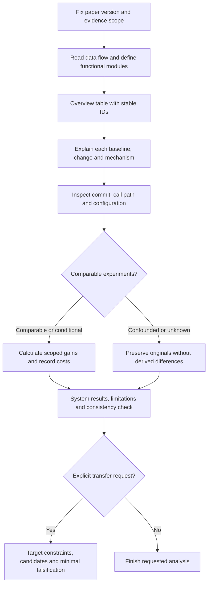

# From a paper to a checkable explanation

[简体中文](workflow.zh-CN.md) · [Home](../README.en.md)

This guide describes the original skill's observable process, decision criteria, and evidence records. It is not a record of a model's private internal reasoning.

## Workflow

## Decisions and records

| Stage | Decision | Checkable record |
|---|---|---|
| Scope | Which version and materials are actually accessible? | Paper version, supplement, source commit, missing evidence |
| Modules | What responsibility has coherent inputs and outputs? | Functional overview; module count is not innovation count |
| Attribution | What existed before, and what changed here? | Before/after behavior, inherited/new/modified/engineering labels, sources |
| Mechanism | What operations, state, information, and constraints matter? | Defined symbols, source equations, lifecycle and coupling |
| Implementation | Is this code on an enabled path? | Repository@SHA, files/symbols, caller→implementation→consumer, flags |
| Gains | What attribution level do the measurements support? | Original values, units, protocols, controls, comparability and costs |
| Conclusion | What is established and what needs evidence? | System results, unresolved items and consistent module IDs |

## Three important judgments

**Separate method lineage from experimental comparators.** The architectural predecessor may differ from the competitor in a results table. Do not replace the paper's actual starting point with a familiar method or label inherited components as new contributions.

**Existing code is not necessarily enabled code.** Inspect callers, consumers, and configuration after locating a symbol. Static correspondence does not prove runtime use or reproduce a published experiment. Keep paper claims, code evidence, reported results, actual reproductions, transfer hypotheses, and unverified items distinct.

**Check comparability before subtraction.** Different datasets, operating points, hardware, budgets, or aggregation can prevent interpretation. Confounded or unknown comparisons receive no derived deltas, ratios, speedups, or rankings. Whole-system results remain whole-system results; explicitly record missing independent ablations.

## Optional transfer branch

Enter only when explicitly requested. Define the target's inputs, outputs, bottleneck, and hard constraints; search primary sources and target-domain prior uses; inspect adapters, retraining, decoder information, and extra costs; propose the cheapest useful falsification. Source-domain gains are not target effect estimates, and finding no prior use does not establish novelty. An experiment plan is not an executed experiment.

## Output and stopping

A full report begins with scope and overview, expands matching module sections, then summarizes system results and limitations. A focused question receives a focused answer. Identify precisely which missing artifact would resolve a gap. Stop once the requested scope is evidenced or a defensible negative finding is reached. Do not automatically scan a library, install dependencies, or train models.

[SKILL.md](../SKILL.md) is authoritative for the original instructions. See [evidence-and-gains.md](../references/evidence-and-gains.md) for numeric evidence rules.
