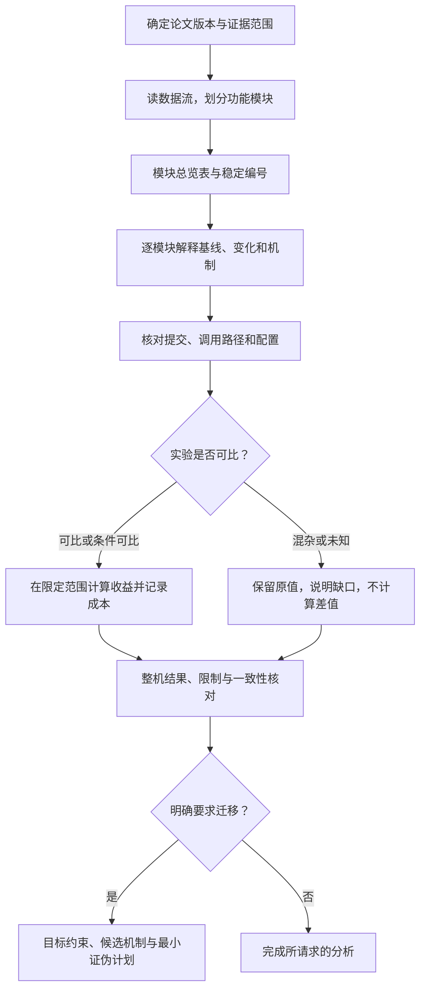

# 从论文到可核验解释

[English](workflow.en.md) · [返回首页](../README.md)

本文是对原版 skill 的阅读指南。这里的“分析方法”指可公开复核的步骤、判断标准与证据记录，不是模型内部推理记录。

## 流程

## 每一步到底判断什么

| 步骤 | 要回答的问题 | 留下的可复核记录 |
|---|---|---|
| 确定范围 | 分析哪个版本，哪些材料实际可读？ | 论文版本、补充材料、仓库提交、缺失材料 |
| 划分模块 | 这个部分负责什么，输入输出能否说明白？ | 以功能为边界的模块表；模块数不等于创新数 |
| 核对归属 | 前作已经有什么，这篇具体改变什么？ | 前后行为、继承/新提案/修改/工程标签和来源 |
| 解释机制 | 为什么这样操作，依赖哪些信息与状态？ | 符号含义、公式出处、生命周期、约束和耦合 |
| 映射实现 | 代码是否真在有效路径中？ | 仓库@SHA、文件与符号、调用者→实现→消费者、开关 |
| 审查收益 | 数据能支持哪一级结论？ | 原值、单位、协议、消融控制、可比性和成本 |
| 收束结论 | 已知、未知和需要补证的边界是什么？ | 整机结果、未核验项及编号一致性检查 |

## 三个关键判断

**方法谱系和实验对手分别记录。** 论文借鉴的方法可能不是结果表里的对手。不能用熟悉的方法替换论文真正的起点，也不能把继承模块写成全新贡献。

**代码存在不等于实际启用。** 找到同名函数后，还要检查谁调用、输出被谁使用、哪个配置打开它。静态源码对应也不等于已经复现实验。论文声称、代码证据、作者报告结果、亲自复现、迁移假设和未核验项应分别标记。

**先问可比，再做减法。** 数据集、质量点、硬件、训练预算或统计方式不同，数值差异可能无法解释。混杂或未知比较不计算任何派生差值、比例、加速比或排序。只有整机结果时就报告整机结果；没有独立消融时明确写“无独立收益证据”。

## 迁移是一条可选支线

只有明确要求后才进入：把目标写成输入、输出、瓶颈和硬约束；检索原始来源与目标领域已有用法；检查适配、重训、解码信息和额外成本；提出能尽早否定假设的小实验。源领域收益不能作为目标收益预测，未搜到先例也不代表已证明创新。实验计划不等于已执行实验。

## 输出与停止条件

完整报告先给范围与总览，再逐模块展开，最后汇总整机结果和限制。只问一个机制时只答这个机制。材料缺失就精确指出需要哪份材料；完成请求范围或得到有证据的否定结论即可结束。无需默认扫描整库、安装环境或运行训练。

具体约束以 [SKILL.md](../SKILL.md) 为准；数字证据细则见 [evidence-and-gains.md](../references/evidence-and-gains.md)。
